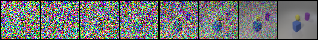
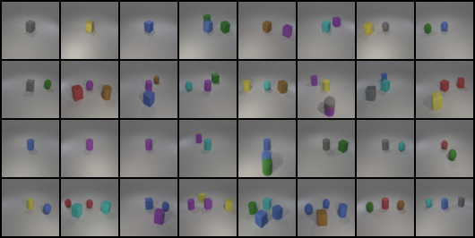
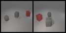
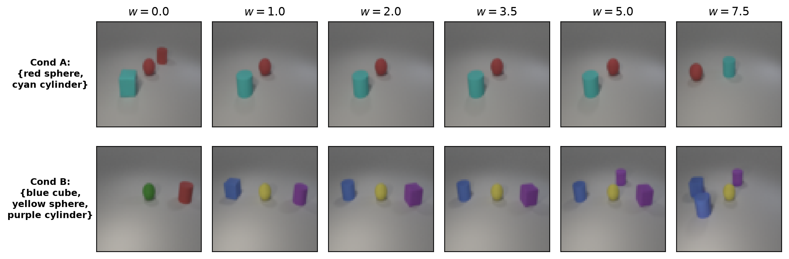
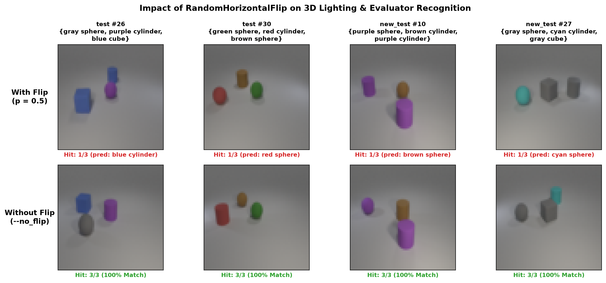

# LAB6 : Conditional DDPM for Image Generation

---

## Introduction
在本次作業中，我將在 i-CLEVR 資料集上實作一個用於 **multi-label** 影像生成的 Conditional Denoising Diffusion Probabilistic Model, DDPM，給定一組物件標籤（例如「綠色球體」、「灰色立方體」），模型要能生成包含這些指定物件的影像。與 unconditional generator 不同，此 denoising model 在每一個 reverse step 中，會同時利用noisy image 以及 object-label condition 來進行運算。最後會探討 model design、conditioning、noise schedules,and sampling choices 如何影響結果。系統會透過一個既定的 classifier，評估生成的影像是否包含所要求的物件。

<figure align="center">
  
  <figcaption style="text-align:left;"><strong>Figure 1.</strong> Conditional DDPM generation. Starting from noise, the model uses the multi-label condition and timestep to repeatedly denoise the image.</figcaption>
</figure>

## Implementation

---

### Data preprocessing & augmentation
在資料前處理階段（src/dataset.py），ICLEVRDataset 會將原始影像統一 resize 至 $64 \times 64$，並透過 `transforms.Normalize((0.5, 0.5, 0.5), (0.5, 0.5, 0.5))` 將像素值從 $[0,1]$線性映射至 $[−1,1]$，使其與 diffusion model 最終的 **Gaussion Noise** 先驗分佈 $N(0,I)$ 的數值範圍對齊。在 **Data Augmentation** 方面，由於 i-CLEVR 的條件僅指定「出現哪些顏色與形狀的物件」（例如 ["blue cube", "yellow sphere"]），並未限制物件在畫面中的左右相對位置，且3D場景中的光源與地面幾何在水平翻轉下依然合理，因此我引入了機率為 0.5 的 `RandomHorizontalFlip`。這能將訓練樣本的多樣性提高一倍並避免模型記住固定構圖；相對地，刻意不使用垂直翻轉或 Color Jitter ，以免破壞地板與陰影的物理方向或改變物件的顏色標籤語意。
```python
# src/dataset.py
tf_list = [transforms.Resize((image_size, image_size))]
if random_flip:
    tf_list.append(transforms.RandomHorizontalFlip(p=0.5))
tf_list.extend(
    [
        transforms.ToTensor(),
        transforms.Normalize((0.5, 0.5, 0.5), (0.5, 0.5, 0.5)),  # [0, 1] -> [-1, 1]
    ]
)
self.transform = transforms.Compose(tf_list)
```

---

### Model architecture
在模型架構方面，我採用基於 HuggingFace `diffusers` 套件的 `UNet2DModel`，再自己寫一個 ConditionalUNet Class 把它包裝起來，加上我自己的  multi-label 條件處理邏輯。針對 i-CLEVR 資料集 $64 \times 64$ 的 RGB 影像，設計了 4 個 layer 的 Encoder-Decoder 結構，對應的 `block_out_channels` 分別為 `(128, 128, 256, 512)`，這些數字是按照原始論文設定，且每個 block 包含 2 個殘差層（`layers_per_block=2`）。

```python
class ConditionalUNet(nn.Module):
    def __init__(
        self,
        num_classes: int = 24,
        sample_size: int = 64,
        block_out_channels: tuple = (128, 128, 256, 512),
    ):
```
為了兼顧計算效率與全域空間關係，我在前兩層（$64 \times 64 \to 32 \times 32 \to 16 \times 16$）使用標準的卷積殘差區塊 `DownBlock2D` 與 `UpBlock2D` 來提取局部特徵；而在深層特徵圖（$16 \times 16 \to 8 \times 8$）則引入帶有 **Self-Attention** 機制的 `AttnDownBlock2D` 與 `AttnUpBlock2D`。這樣的設計能讓模型在計算量可控的前提下，於低維特徵空間有效捕捉多個物件（如球體、立方體、圓柱體）之間的相對空間位置與幾何結構，避免多個物件重疊或形狀扭曲。

```python
# model/unet.py
self.unet = UNet2DModel(
    sample_size=sample_size,
    in_channels=3,
    out_channels=3,
    layers_per_block=2,
    block_out_channels=block_out_channels,  # (128, 128, 256, 512)
    down_block_types=(
        "DownBlock2D",       # 64 -> 32
        "DownBlock2D",       # 32 -> 16
        "AttnDownBlock2D",   # 16 -> 8
        "AttnDownBlock2D",   # 8 -> 8
    ),
    up_block_types=(
        "AttnUpBlock2D",
        "AttnUpBlock2D",
        "UpBlock2D",
        "UpBlock2D",
    ),
    class_embed_type="identity",
)
```

---

### Condition embedding
由於 i-CLEVR 是  multi-label 生成任務（每張圖包含 1 至 3 個物件，共 24 種物件類別），無法直接使用單一類別索引的 `nn.Embedding` 查找表。因此，先將每筆資料的物件轉為24維的 multi-hot 浮點數向量 $\mathbf{y} \in \{0, 1\}^{24}$，接著透過一個兩層的 Multi-Layer Perceptron (`label_emb`)，搭配 `SiLU` activation function，將 24 維的條件向量投影至與 **timestep embedding** 相同的維度（`time_embed_dim = block_out_channels[0] * 4 = 512`）。

把 `UNet2DModel` 的 `class_embed_type` 設為 `"identity"` ，這是因為 `UNet2DModel` 預設的 `class_embed_type` 只支援單一整數 ID 的查表。這裡設定為 `"identity"`（恆等映射），意思是告訴 `UNet2DModel`：不要用內建的 embedding 層處理 `class_labels` 了，我傳進去的值已經是我自己算好的 512 維向量，直接把它加到 time_emb 上。投影後的 512 維 condition embedding 就能透過 `class_labels` 參數直接傳入 U-Net，在內部與 timestep embedding 相加融合，並注入至每一個 ResNet block 中。此外，這種以線性層處理 multi-hot 向量的設計能支援 Classifier-Free Guidance (CFG)：當訓練或推論需要 unconditional 輸入時，只需傳入全為 0 的向量 $\mathbf{0} \in \mathbb{R}^{24}$ 即可作為 null condition。

```python
# model/unet.py
time_embed_dim = block_out_channels[0] * 4  # 128 * 4 = 512

self.label_emb = nn.Sequential(
    nn.Linear(num_classes, time_embed_dim),
    nn.SiLU(),
    nn.Linear(time_embed_dim, time_embed_dim),
)

def forward(self, x: torch.Tensor, t: torch.Tensor, y: torch.Tensor) -> torch.Tensor:
    # y: (B, 24) multi-hot float tensor；CFG unconditional 時傳全 0 向量即可
    cond = self.label_emb(y.to(dtype=x.dtype))
    return self.unet(x, t, class_labels=cond).sample
```

---

### Noise schedule

針對 $64 \times 64$ 這類解析度較低的影像，Cosine schedule（`squaredcos_cap_v2`）能讓 $\bar{\alpha}_t$ 以平滑的餘弦曲線遞減，避免像傳統 Linear schedule 在擴散前中期過快破壞影像結構，導致後期 timestep 過早退化為純 noise 而浪費訓練資源；而 Linear schedule（$\beta_1 = 10^{-4}$ 至 $\beta_T = 0.02$）則提供穩定的 baseline。

```python
# model/diffusion.py
self.noise_scheduler = DDPMScheduler(
    num_train_timesteps=num_train_timesteps,  # 1000
    beta_start=beta_start,                    # 1e-4
    beta_end=beta_end,                        # 0.02
    beta_schedule=beta_schedule,              # "squaredcos_cap_v2" or "linear"
    clip_sample=clip_sample,
    prediction_type=prediction_type,
)

def q_sample(self, x_0: torch.Tensor, t: torch.Tensor, noise: Optional[torch.Tensor] = None):
    if noise is None:
        noise = torch.randn_like(x_0)
    x_t = self.noise_scheduler.add_noise(x_0, noise, t)
    return x_t, noise
```

---

### Timestep embedding
在訓練階段，每個 batch 會隨機採樣 $t$ 並連同 x_t、y_cond 傳入模型，內部的 Sinusoidal Positional Embedding 與投影則由 UNet2DModel 自動處理

```python
# model/diffusion.py
t = torch.randint(
    0,
    self.num_train_timesteps,
    (batch_size,),
    device=device,
    dtype=torch.long,
)

x_t, noise = self.q_sample(x_0, t)

y_cond = self.drop_condition(y)

pred = model(x_t, t, y_cond)
```

---

### Loss
模型採用 $\epsilon$-prediction（`prediction_type="epsilon"`）作為學習目標，即訓練神經網路預測在 Forward Process 中所加入的 Gaussian noise $\boldsymbol{\epsilon} \sim \mathcal{N}(\mathbf{0}, \mathbf{I})$，並以 Mean Squared Error (MSE) 作為損失函數：
$$\mathcal{L}_{\text{simple}} = \mathbb{E}_{\mathbf{x}_0, \mathbf{y}, t, \boldsymbol{\epsilon}} \left[ \| \boldsymbol{\epsilon} - \boldsymbol{\epsilon}_\theta(\mathbf{x}_t, t, \tilde{\mathbf{y}}) \|_2^2 \right]$$

為了強化生成影像對 **multi-label condition** 的準確率，我採用了 **Classifier-Free Guidance (CFG)**。相較於傳統 Classifier Guidance 需要額外在各種加噪程度的影像 $\mathbf{x}_t$ 上訓練一個獨立的分類器並計算梯度，CFG 的核心思想是**讓同一個 U-Net 同時學習有條件（conditional, $\boldsymbol{\epsilon}_\theta(\mathbf{x}_t, t, \mathbf{y})$）與無條件（unconditional, $\boldsymbol{\epsilon}_\theta(\mathbf{x}_t, t, \mathbf{0})$）的雜訊預測**，並在**推論**時利用兩者的差值作為 implicit classifier gradient 的方向進行強化。$$\hat{\boldsymbol{\epsilon}} = \boldsymbol{\epsilon}_\theta(\mathbf{x}_t, t, \mathbf{0}) + w \cdot \underbrace{\left( \boldsymbol{\epsilon}_\theta(\mathbf{x}_t, t, \mathbf{y}) - \boldsymbol{\epsilon}_\theta(\mathbf{x}_t, t, \mathbf{0}) \right)}_{\text{implicit classifier gradient direction}}$$ 為此，在訓練過程中我實作了 `drop_condition` 機制：每個樣本有 $p_{\text{uncond}} = 0.1$ 的機率將其 multi-hot 條件向量 $\mathbf{y}$ 清零為 null condition $\mathbf{0}$，使單一模型兼具條件與無條件生成能力。

```python
# model/diffusion.py
def drop_condition(self, y: torch.Tensor) -> torch.Tensor:
    if self.p_uncond <= 0.0:
        return y
    keep_mask = (torch.rand(y.size(0), 1, device=y.device) >= self.p_uncond).to(y.dtype)
    return y * keep_mask

def training_loss(self, model: nn.Module, x_0: torch.Tensor, y: torch.Tensor) -> torch.Tensor:
    t = torch.randint(0, self.num_train_timesteps, (x_0.size(0),), device=x_0.device, dtype=torch.long)
    x_t, noise = self.q_sample(x_0, t)
    y_cond = self.drop_condition(y)
    pred = model(x_t, t, y_cond)
    return F.mse_loss(pred, noise)
```

---

### Sampling method
在 **denoising** 階段，我整合了 Classifier-Free Guidance (CFG) 與能夠支援 `DDPM` / `DDIM` 兩種取樣流程。從標準常態分佈抽樣出初始雜訊 $\mathbf{x}_T \sim \mathcal{N}(\mathbf{0}, \mathbf{I})$ 後，在每一個時間步 $t$，將 unconditional 輸入（$\mathbf{0}$）與 conditional 輸入（$\mathbf{y}$）沿著 batch 維度拼接為 $2B$ 大小，藉由單次 forward pass 同時取得 $\boldsymbol{\epsilon}_\theta(\mathbf{x}_t, t, \mathbf{0})$ 與 $\boldsymbol{\epsilon}_\theta(\mathbf{x}_t, t, \mathbf{y})$，再透過 guidance scale $w$（預設為 `3.5`）進行線性外插：
$$\hat{\boldsymbol{\epsilon}} = \boldsymbol{\epsilon}_\theta(\mathbf{x}_t, t, \mathbf{0}) + w \cdot \left( \boldsymbol{\epsilon}_\theta(\mathbf{x}_t, t, \mathbf{y}) - \boldsymbol{\epsilon}_\theta(\mathbf{x}_t, t, \mathbf{0}) \right)$$
設定 $w > 1.0$ 能顯著強化生成影像與指定物件顏色、形狀的一致性，大幅提升 ResNet-18 evaluator 的辨識準確率。此外，透過 `_build_sampler` 切換 `DDPMScheduler` 或 `DDIMScheduler`，不僅能以經典的 DDPM 隨機 denoising 取樣，也能利用 DDIM 在 `100` 步內快速完成高品質的確定性（$\eta = 0.0$）推論，並在每步將輸出 clamp 至 $[-1, 1]$ 以維持數值穩定。
* **DDPM (`DDPMScheduler`)**：遵循隨機 Markovian reverse process，每步加入隨機雜訊 $\sigma_t \mathbf{z}$：
  $$\mathbf{x}_{t-1} = \frac{1}{\sqrt{\alpha_t}}\left(\mathbf{x}_t - \frac{1 - \alpha_t}{\sqrt{1 - \bar{\alpha}_t}}\hat{\boldsymbol{\epsilon}}_\theta\right) + \sigma_t \mathbf{z}, \quad \mathbf{z} \sim \mathcal{N}(\mathbf{0}, \mathbf{I})$$
* **DDIM (`DDIMScheduler`)**：利用 Non-Markovian 跳步過程，當設定 $\eta = 0.0$ 時即為 deterministic 的 ODE 求解器，能以 `100` 個子時間步快速生成清晰且具高重現性的影像。
此外，`sample()` 方法內建了 `return_trajectory` 機制，會等距記錄從純雜訊到最終成品共 8 個間點的 denosie snapshot。

```python
# model/diffusion.py
def predict_cfg(
    self,
    model: nn.Module,
    x_t: torch.Tensor,
    t: torch.Tensor,
    y: torch.Tensor,
    guidance_scale: float = 3.5,
) -> torch.Tensor:
    # 將 unconditional (全 0) 與 conditional 拼成 2B 的 batch 一次前向傳播
    x_in = torch.cat([x_t, x_t], dim=0)
    t_in = torch.cat([t, t], dim=0)
    y_in = torch.cat([torch.zeros_like(y), y], dim=0)

    pred_uncond, pred_cond = model(x_in, t_in, y_in).chunk(2, dim=0)
    return pred_uncond + guidance_scale * (pred_cond - pred_uncond)
```

## Results and discussion
---
### Results
以下是本次實驗在 Training 與 Sampling 所使用的超參數配置：
| Hyperparameter | Value |
| :--- | :--- |
| **Image resolution** | 64 × 64 |
| **Epochs** | 150 |
| **Batch size** | 64 |
| **Optimizer** | AdamW |
| **Learning rate** | 1e-4 |
| **Weight decay** | 1e-4 |
| **LR scheduler** | LambdaLR (500 warmup steps + cosine decay) |
| **Gradient clipping** | 1.0 |
| **EMA decay** | 0.999 |
| **Training timesteps ($T$)** | 1000 |
| **Noise schedule** | squaredcos_cap_v2 |
| **Prediction objective / Loss** | $\epsilon$-prediction (MSE) |
| **CFG dropout probability ($p_{\text{uncond}}$)** | 0.1 |
| **CFG guidance scale ($w$)** | 3.5 |
| **Inference steps** | 100 |
<p align="center"><sub><b>Table 1:</b> Training hyperparameters.</sub></p>

| Hyperparameter | Value |
| :--- | :--- |
| **Sampler** | DDPM |
| **Inference steps** | 100 |
| **Guidance scale ($w$)** | 3.5 |
| **Image resolution** | 64 × 64 |
| **Model weights** | EMA weights (`ema_state_dict`) |
| **Trajectory steps** | 8 (for denoising process grid) |
| **Random seed** | 42 |
<p align="center"><sub><b>Table 2:</b> Sampling hyperparameters.</sub></p>

我載入 Exponential Moving Average (EMA) 權重，針對 test.json 與 new_test.json 兩組測試條件（各 32 組multi-label 物件組合）進行影像生成，並使用 pretrain ResNet-18 Evaluator 評估 Top-k Accuracy：

<figure align="center">
  
  <figcaption style="text-align:center;"><sub><b>Figure 2:</b> Results</sub></figcaption>
</figure>

從 **Figure 2** 可以看到，模型在 test.json 上達到了 88.89% (0.8889) 的高準確率，而 new_test.json 上也達到了 86.90% (0.8690)，兩者皆穩定超過 0.80 的基準門檻。這項結果證明了：

- 標準 Conditional U-Net 架構的高效性：即使未採用複雜的 Cross-Attention 機制，單純透過兩層 MLP 將 24 維 Multi-hot conditional embedding 投影後與 Timestep Embedding 相加，並配合深層特徵圖（16×16 與 8×8）的 Spatial Self-Attention，一般的 2D U-Net 便足以精準捕捉多物件的顏色與幾何形狀特徵。
- Compositional Generalizatio：test.json 與 new_test.json 的準確率差距僅約 2%，顯示模型並非死記訓練集中的特定物件組合，而是真正學會了將「顏色（8 種）」與「形狀（球體、立方體、圓柱體）」進行 semantic disentanglement，並在 Classifier-Free Guidance (w=3.5) 與 EMA 權重平滑的輔助下，穩定合成出符合條件的影像。

<figure align="center">
  
  <figcaption style="text-align:center;"><sub><b>Figure 3:</b> Condition {blue cube, yellow sphere, purple cylinder} denoising process</sub></figcaption>
</figure>

**Figure 3** 顯示出，從標準常態分佈 $N(0,I)$ 採樣出來的 Gaussian Noise，不帶有任何資訊，透過訓練好的 U-Net 逐步預測並減去雜訊，最後收斂出符合目標分佈與 Condition 的結果。

<figure align="center">
  
  <figcaption style="text-align:center;"><sub><b>Figure 4:</b> Grid test</sub></figcaption>
</figure>

<figure align="center">
  
  <figcaption style="text-align:center;"><sub><b>Figure 5:</b> Grid new test</sub></figcaption>
</figure>


### Ablation study
---
#### DDPM vs. DDIM
在推論階段，我固定模型權重（EMA）、Guidance Scale ($w = 3.5$)、推論步數（`num_inference_steps = 100`）與 random seed（`seed = 42`），比較 **DDPM** 與 **DDIM ($\eta = 0.0$)** 的表現

| **Sampler** | **Steps** | **$\eta$** | `test.json` Acc (%) | `new_test.json` Acc (%) | **Avg Acc (%)** |
| :---: | :---: | :---: | :---: | :---: | :---: |
| **DDPM (Ours)** | 100 | 1.0 (Stochastic) | **88.89** | **86.90** | **87.90** |
| **DDIM** | 100 | 0.0 (Deterministic) | 76.39 | 72.62 | 74.51 |

從實驗結果可以觀察到，在相同的 100 步推論設定下，**DDPM 的平均準確率高出 DDIM 約 13.4%**。可以從 **diffusion process** 的機制分析其原因如下：
1. **Stochastic Error Correction**：DDIM ($\eta = 0.0$) 將 **denoising process** 視為 deterministic 的常微分方程（ODE）軌跡，過程中不再注入隨機雜訊（$\sigma_t = 0$）。在 i-CLEVR multi-label 生成圖片任務中，若 denoising 初期（高雜訊階段）某個物件的空間位置重疊或特徵強度不足，deterministic 軌跡無法在後續步驟跳出該局部狀態，導致初期預測誤差一路累積至 $\mathbf{x}_0$（容易出現漏畫物件或色彩混疊）。相對地，DDPM 在每一步皆注入隨機擾動 $\sigma_t \mathbf{z}$，類似 Langevin dynamics 的隨機探索，能打破早期的不良局部構圖，並配合 CFG ($w=3.5$) 的梯度持續將影像拉回正確的 data manifold 。
2. **高 Guidance Scale 下的截斷誤差緩衝**：在 $w = 3.5$ 的線性外插下，預測的 $\hat{\mathbf{x}}_0$ 較容易觸發 `clip_sample=True` 的 $[-1, 1]$ 邊界截斷。DDPM 每步注入的 Gaussion Noise 能有效平滑截斷帶來的數值僵化，使最終生成的 3D 幾何邊緣與光影更加自然，更符合 ResNet-18 Evaluator 的特徵分佈。

---

#### EMA vs. Raw

在 Diffusion Model 的訓練過程中，由於每個 step 都會隨機抽樣時間步 $t$、Gaussion Noise $\epsilon$ 以及以 $p_{\text{uncond}}=0.1$ Classifier-Free Guidance dropout，目標函數的梯度具有較高的隨機性與方差。若直接使用最後一步的 RAW weights 進行推論，模型參數容易受到最後幾個 mini-batch 的梯度震盪影響。

為了穩定生成品質，我在訓練時維護了一組 **Exponential Moving Average, EMA** 權重，更新公式如下：

$$\theta_{\text{EMA}}^{(t)} = \beta_t \theta_{\text{EMA}}^{(t-1)} + (1 - \beta_t)\theta_{\text{RAW}}^{(t)}, \quad \beta_t = \min\left(0.999, \frac{1 + t}{10 + t}\right)$$

其中動態衰減率 $\beta_t$ 包含初期的 warmup 機制，避免訓練初期尚未收斂的權重拖慢 EMA 更新，並在訓練中後期維持 $\beta = 0.999$ 的平滑效果。

| **Model weights** | `test.json` Acc (%) | `new_test.json` Acc (%) | **Average Acc (%)** |
| --- | :---: | :---: | :---: |
| EMA | **88.89** | 86.90 | 87.90 |
| RAW | 87.50 | **90.48** | **88.99** |

**實驗結果分析：**
1. **兩者在不同測試集上互有勝負（差距僅 1～3 個物件標籤）**：
   * 在 `test.json`（共 72 個物件標籤）中，**EMA weights**表現較佳，達到 **$88.89\%$**（命中 $64/72$），高於 RAW weights 的 $87.50\%$（命中 $63/72$），展現出對一般條件組合更穩定的生成能力。
   * 在 `new_test.json`（共 84 個物件標籤）中，**RAW weights**則達到 **$90.48\%$**（命中 $76/84$），高於 EMA weights 的 $86.90\%$（命中 $73/84$），使 RAW 的整體平均準確率微幅領先約 $1.09\%$。
2. **為何 RAW 在 `new_test.json` 能取得更高分？**：
   * **Learning rate scheduling 後期已自然收斂**：本實驗在訓練時採用了 **Cosine Annealing learning rate scheduling**並搭配 Gradient Clipping。因此在訓練後期，RAW weights 本身的參數更新幅度已經非常小，並未出現劇烈的梯度震盪，能精準貼合訓練末期對複雜多物件組合（如 `new_test.json` 中較密集的 3 物件條件）的微調成果。
   * **EMA Temporal Lag**：由於 EMA 採用高達 $\beta = 0.999$ 的衰減率（約等價於過去 1000 個 step 的指數加權平均），其權重包含了較早期的歷史參數軌跡。當模型在訓練後期針對高難度條件組合進一步提升特徵銳利度時，EMA 權重的更新會有些微 lag 與 smoothing，導致 ResNet-18 Evaluator 對少數重疊或相近色物體（如 `cyan` vs. `blue`、`purple` vs. `red`）的 Top-$k$ 信心度略低於最後一刻的 RAW 權重。
3. **Evaluator Accuracy 與 Visual Fidelity 的權衡**：
   * 雖然 RAW weights 在 ResNet-18 分類器上的平均分數略高 1.09%，但在 **Figure 6** 可以看到，左邊是 raw weights 生成的，右邊為 EMA weights 生成的影像，以視覺品質來看，**EMA weights** 生成的背景更乾淨、幾何物體邊緣與光影更平滑；而 **RAW weights**生成的物體特徵與顏色對比通常較為銳利，這雖然有助於 ResNet-18 分類器辨識出正確類別，但偶爾會在邊緣伴隨些微的高頻雜訊。這也驗證了 EMA 的核心價值在於**減少生成畫面的高頻雜訊，並讓模型在不同測試集上的表現更加穩定一致**（EMA 在兩個測試集的落差僅 1.99%，而 RAW 的落差為 2.98%）。

<figure align="center">
  
  <figcaption style="text-align:center;"><sub><b>Figure 6</b></sub></figcaption>
</figure>

---

#### CFG Guidance Scale (*w*)
固定模型權重（EMA）、取樣器（DDPM, 100 steps）與 random seed（seed = 42），測試 $w∈{0.0,1.0,2.0,3.5,5.0,7.5}$ 對 Evaluator 準確率與視覺品質的影響：
| Guidance Scale (*w*) | `test.json` Acc (%) | `new_test.json` Acc (%) |  視覺特徵簡述 |
| :---: | :---: | :---: |  --- |
| 0 (Uncond.) |  4.17 | 5.95 | 隨機生成，與目標標籤無關 |
| 1 (No CFG) |  70.83 | 80.95 | 條件正確率偏低，易漏物體或顏色混濁 |
| 2 | 76.39 |  88.10 | 物體數量與顏色逐漸對齊 |
| 3.5 (Ours) |  88.89 | 86.90 | 形狀清晰、光照自然 |
| 5 | 79.17 | 86.90  | 對比度上升，陰影加深 |
| 7 | 80.56 | 83.33 | 色彩過飽和、邊緣色塊偽影、背景色偏 |

<figure align="center">
  
  <figcaption style="text-align:center;"><sub><b>Figure 7</b></sub></figcaption>
</figure>

**實驗結果分析：**

1. **無條件生成與基礎條件生成（$w = 0.0 \to 1.0$）**：
   * 當 **$w = 0.0$** 時，條件差值項完全被消除，模型退化為純 unconditional generator。如 **Figure 7** 最左欄所示，`Cond A` 生成了未指定的紅色圓柱且將青色圓柱誤畫為立方體，`Cond B` 則隨機生成了無關的綠球與紅柱，因此兩組測試集的準確率僅有 $4.17\%$ 與 $5.95\%$（接近隨機猜測）。
   * 當 **$w = 1.0$**（無 CFG 外插放大）時，模型已能接收條件訊號，平均準確率大幅跳升至 $75.89\%$，但在 `test.json` 上僅有 $70.83\%$，顯示單靠原始條件機率分佈 $p_\theta(\mathbf{x}_t | \mathbf{y})$ 對 multi-label 特徵的約束力仍嫌不足。

2. **最佳平衡點（Sweet Spot at $w = 2.0 \sim 3.5$）**：
   * 當 $w$ 提升至 **$2.0 \sim 3.5$** 時，放大的 implicit classifier gradient 能引導 U-Net 在 denoising 初期就將不同物件的顏色與幾何輪廓清晰分離。在 **$w = 3.5$** 時模型取得最高的整體平均準確率 **$87.90\%$**（`test.json` 達最高分 **$88.89\%$**），且畫面光影與 3D 幾何邊緣最為自然。
3. **為何高 Guidance Scale（$w = 5.0 \sim 7.5$）在 `Cond A` 仍相符，在 `Cond B` 卻會失效？**
   * 從 **Figure 7** 可以觀察到一個關鍵差異：對於僅包含 **2 個物件的 `Cond A` `{red sphere, cyan cylinder}`**，從 $w = 1.0$ 一路增加到 $w = 7.5$，畫面皆能穩定維持「1 顆紅球＋1 個青色圓柱」的正確構圖；然而對於包含 **3 個物件的 `Cond B` `{blue cube, yellow sphere, purple cylinder}`**，當 $w$ 增加至 **$5.0$** 時，右後方卻**多長出了第 2 個紫色圓柱體（變成 4 個物件）**；到了 **$w = 7.5$** 時失真更加嚴重，左前方甚至**額外分裂出第 2 個藍色物件**，且原本 `blue cube` 與 `purple cylinder` 的方塊和圓柱幾何特徵也發生混淆。
   * **原因剖析（Feature Over-excitation 與 Off-manifold Extrapolation）**：
     1. **條件引導過強，導致模型重複畫出相同物體**：在 `Cond B` 這類 3 物件條件下，24 維 multi-hot 向量同時畫出三組不同的顏色與形狀特徵。當 $w \ge 5.0$ 時，條件修正項 $w \cdot (\boldsymbol{\epsilon}_{\text{cond}} - \boldsymbol{\epsilon}_{\text{uncond}})$ 被過度放大，導致去噪初期特徵圖上多個空間位置同時對特定顏色（如紫色、藍色）產生極端響應，進而在背景空白處 hallucinate 出多餘的重複物件。相比之下，`Cond A` 只有 2 個物件，空間佔用較低、特徵交互干擾小，因此對高 $w$ 的容忍度較高。

---

#### Noise Schedule

在 Forward Diffusion Process 中，Noise Schedule 決定了訊號保留率 $\bar{\alpha}_t = \prod_{s=1}^t (1 - \beta_s)$ 隨時間步 $t \in [1, T]$ 衰減的速度。固定其餘超參數，比較傳統 DDPM 的 **Linear schedule**（$\beta_t$ 由 $10^{-4}$ 線性遞增至 $0.02$）與 Improved DDPM 提出的 **Cosine schedule (`squaredcos_cap_v2`)**：

$$\bar{\alpha}_t = \frac{f(t)}{f(0)}, \quad f(t) = \cos^2\left(\frac{t/T + s}{1 + s} \cdot \frac{\pi}{2}\right)$$

| **Noise Schedule** | `test.json` Acc (%) | `new_test.json` Acc (%) | **Average Acc (%)** |
| :---: | :---: | :---: | :---: |
| **Cosine (`squaredcos_cap_v2`, Ours)** | **88.89** | **86.90** | **87.90** |
| **Linear** | 84.72 | 79.72 | 82.22 |

**實驗結果分析：**
1. **Cosine Schedule 在兩組測試集全面領先（平均提升 $+5.68\%$）**：
   * 在 `test.json` 上，Cosine 排程較 Linear 提升了 **$4.17\%$**（$88.89\%$ vs. $84.72\%$）；而在多物件組合更密集的 `new_test.json` 上，領先幅度更擴大至 **$7.18\%$**（$86.90\%$ vs. $79.72\%$）。
2. **低解析度影像（$64 \times 64$）下的訊噪比（SNR）衰減特性**：
   * **Linear schedule 的前中期過快崩潰問題**：Linear schedule 最初是針對 $256 \times 256$ 高解析度影像所設計。在 $64 \times 64$ 的低解析度影像中，空間像素冗餘度較低，Linear schedule 的 $\bar{\alpha}_t$ 在擴散前中期便迅速衰減至接近 $0$，導致時間步後段（$t \to T$）有高比例的區間幾乎退化為 Pure Gaussion noise，造成訓練步數的浪費。
   * **Cosine schedule 的平滑過渡優勢**：Cosine schedule 讓 $\bar{\alpha}_t$ 在中間時間步（$t \in [200, 800]$）呈現近乎線性的平緩下降。這正是 diffusion model 決定「多個物件的空間配置與幾何輪廓」的階段，充裕的時間步讓 U-Net 能更從容的 decouple 3 個物件的位置與形狀，因此在高難度的 `new_test.json` 上展現出顯著優勢。

<figure align="center">
  
  <figcaption style="text-align:center;"><sub><b>Figure 8:</b> Signal Retention Rate $\bar{\alpha}_t$ along Reverse Process ($t = 1000 \rightarrow 0$)</sub></figcaption>
</figure>
<figure align="center">
  
  <figcaption style="text-align:center;"><sub><b>Figure 9:</b> Denoising Trajectory Comparison</sub></figcaption>
</figure>

從 **Figure 8** 與 **Figure 9** 的對照可以清楚驗證上述分析：在 Figure 8 中，Linear schedule（紅線）在 denoising process 的前大半段（$t = 1000 \to 400$）訊號保留率 $\bar{\alpha}_t$ 皆趨近於 $0$；對應到 **Figure 9** 下排的 `Linear` denoising 軌跡，從 Step 0 到 Step 5（$t \approx 1000 \to 286$）畫面幾乎仍為高頻雜訊，直到最後兩步（Step 6、Step 7）物件才成形，最終只成功畫出 2 個清晰物件（漏畫或重疊了第 3 個物件）。相對地，**Figure 9** 上排的 `Cosine (Ours)` 早在 Step 3 與 Step 4（$t \approx 571 \to 429$）便已清楚浮現出 3 個物件的空間構圖與色彩雛形，最終在 Step 7 穩定收斂出三個獨立且形狀銳利的幾何物件。

---

#### Data Augmentation (`RandomHorizontalFlip`)

在 Implementation 階段，我原先假設 i-CLEVR 的 label 僅指定物件的**顏色與形狀**而不限制左右位置，因此預設引入了機率為 $0.5$ 的隨機水平翻轉（`RandomHorizontalFlip(p=0.5)`）。為了驗證此假設，我比較了啟用（`With Flip`）與停用（`Without Flip`, `--no_flip`）水平翻轉的訓練結果：

| **RandomHorizontalFlip** | `test.json` Acc (%) | `new_test.json` Acc (%) | **Average Acc (%)** |
| :---: | :---: | :---: | :---: |
| With Flip ($p = 0.5$) | 88.89 | 86.90 | 87.90 |
| **Without Flip (`--no_flip`)** | **94.44** | **96.43** | **95.44** |

**實驗結果分析：**
實驗結果顯示了一個關鍵且出乎意料的現象：**停用水平翻轉（Without Flip）後，模型在 `test.json` 與 `new_test.json` 的準確率分別暴增至 $94.44\%$ 與 $96.43\%$（平均準確率高達 $95.44\%$，較啟用翻轉提升了 $+7.54\%$）**。我檢視 i-CLEVR 資料集的物理渲染特性與 Evaluator 機制，分析出以下兩點核心原因：

1. **3D 渲染場景的 Directional Lighting Asymmetry**：
   * 雖然水平翻轉不會改變物件的「顏色與形狀 label 語意」，但 i-CLEVR 沿用了原始 CLEVR 的渲染架構，透過 Blender 渲染時，所有物件表面的高光反射點 Specular Highlight 與地面投射陰影 Cast Shadow 皆具有一致的方向性。
   * 當訓練時加入 `RandomHorizontalFlip(p=0.5)`，相當於強迫 U-Net 同時學習「左亮右暗」與「右亮左暗」兩種截然相反的雙峰光影分佈（Bimodal Lighting Distribution）。這不僅增加了模型收斂的負擔，也容易使生成物件表面的高光與地面陰影變得模糊或雙側平均化——而**表面高光與陰影輪廓正是區分 3D 球體、圓柱體與立方體幾何曲率的最關鍵視覺線索**。
2. **與下游 Evaluator 特徵分佈的一致性（可能）**：
   * 由於 ResNet-18 Evaluator 主要是透過局部邊緣與表面明暗梯度來區分 3D 幾何形狀（如球體、圓柱與立方體的高光曲率差異），若預訓練分類器本身是在原始固定光源方向的 i-CLEVR 影像上訓練，則不經翻轉的生成影像在光影方向上能與分類器的訓練分佈更緊密對齊，進而取得更高的 Top-$k$ 辨識信心度。

<figure align="center">
  
  <figcaption style="text-align:center;"><sub><b>Figure 10:</b> Visual and Evaluator comparison between models trained with <code>RandomHorizontalFlip(p=0.5)</code> (top row) and without horizontal flip <code>--no_flip</code> (bottom row) under identical test conditions.</sub></figcaption>
</figure>

從 **Figure 10** 的對照案例可以直觀看出：在 `With Flip`（上排）中，由於模型同時學習了左右相反的光源分佈，部分生成物件的表面高光與地面投射陰影較為模糊或方向不一致，導致 ResNet-18 Evaluator 容易將相近幾何形狀（如球體與圓柱體）或相近色系混淆（僅命中 $2/3$）；而在 `Without Flip`（下排）中，所有物件的高光位置與陰影投射方向高度一致、3D 幾何稜角與曲率更加銳利，使分類器能穩定達到 $3/3$ 的 $100\%$ 辨識率。