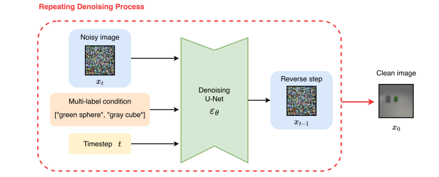
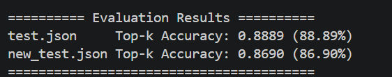
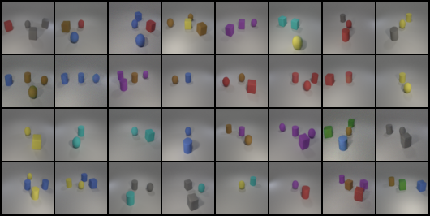
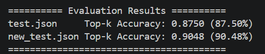

# LAB6 : Conditional DDPM for Image Generation

## Introduction
在本次作業中，我將在 i-CLEVR 資料集上實作一個用於多標籤影像生成的 Conditional Denoising Diffusion Probabilistic Model, DDPM，給定一組物件標籤（例如「綠色球體」、「灰色立方體」），模型要能生成包含這些指定物件的影像。與 unconditional generator 不同，此 denoising model 在每一個 reverse step 中，會同時利用noisy image 以及 object-label condition 來進行運算。最後會探討 model design、conditioning、noise schedules,and sampling choices 如何影響結果。系統會透過一個既定的 classifier，評估生成的影像是否包含所要求的物件。

<figure align="center">
  
  <figcaption style="text-align:left;"><strong>Figure 1.</strong> Conditional DDPM generation. Starting from noise, the model uses the multi-label condition and timestep to repeatedly denoise the image.</figcaption>
</figure>

## Implementation

### Data preprocessing & augmentation
在資料前處理階段（src/dataset.py），ICLEVRDataset 會將原始影像統一 resize 至 $64 \times 64$，並透過 `transforms.Normalize((0.5, 0.5, 0.5), (0.5, 0.5, 0.5))` 將像素值從 $[0,1]$線性映射至 $[−1,1]$，使其與擴散模型最終的標準高斯雜訊先驗分佈 $N(0,I)$ 的數值範圍對齊。在 **Data Augmentation** 方面，由於 i-CLEVR 的條件僅指定「出現哪些顏色與形狀的物件」（例如 ["blue cube", "yellow sphere"]），並未限制物件在畫面中的左右相對位置，且3D場景中的光源與地面幾何在水平翻轉下依然合理，因此我引入了機率為 0.5 的 `RandomHorizontalFlip`。這能將訓練樣本的多樣性提高一倍並避免模型記住固定構圖；相對地，我刻意不使用垂直翻轉或 Color Jitter ，以免破壞地板與陰影的物理方向或改變物件的顏色標籤語意。
```python
# src/dataset.py
tf_list = [transforms.Resize((image_size, image_size))]
if random_flip:
    tf_list.append(transforms.RandomHorizontalFlip(p=0.5))
tf_list.extend(
    [
        transforms.ToTensor(),
        transforms.Normalize((0.5, 0.5, 0.5), (0.5, 0.5, 0.5)),  # [0, 1] -> [-1, 1]
    ]
)
self.transform = transforms.Compose(tf_list)
```
### Model architecture
在模型架構方面，我採用基於 HuggingFace `diffusers` 套件的 `UNet2DModel`，再自己寫一個 ConditionalUNet Class 把它包裝起來，加上我們自己的  multi-label 條件處理邏輯。針對 i-CLEVR 資料集 $64 \times 64$ 的 RGB 影像，設計了 4 個 layer 的 Encoder-Decoder 結構，對應的 `block_out_channels` 分別為 `(128, 128, 256, 512)`，這些數字是按照原始論文設定，且每個 block 包含 2 個殘差層（`layers_per_block=2`）。

```python
class ConditionalUNet(nn.Module):
    def __init__(
        self,
        num_classes: int = 24,
        sample_size: int = 64,
        block_out_channels: tuple = (128, 128, 256, 512),
    ):
```
為了兼顧計算效率與全域空間關係，我在前兩層（$64 \times 64 \to 32 \times 32 \to 16 \times 16$）使用標準的卷積殘差區塊 `DownBlock2D` 與 `UpBlock2D` 來提取局部特徵；而在深層特徵圖（$16 \times 16 \to 8 \times 8$）則引入帶有 **Self-Attention** 機制的 `AttnDownBlock2D` 與 `AttnUpBlock2D`。這樣的設計能讓模型在計算量可控的前提下，於低維特徵空間有效捕捉多個物件（如球體、立方體、圓柱體）之間的相對空間位置與幾何結構，避免多個物件重疊或形狀扭曲。

```python
# model/unet.py
self.unet = UNet2DModel(
    sample_size=sample_size,
    in_channels=3,
    out_channels=3,
    layers_per_block=2,
    block_out_channels=block_out_channels,  # (128, 128, 256, 512)
    down_block_types=(
        "DownBlock2D",       # 64 -> 32
        "DownBlock2D",       # 32 -> 16
        "AttnDownBlock2D",   # 16 -> 8
        "AttnDownBlock2D",   # 8 -> 8
    ),
    up_block_types=(
        "AttnUpBlock2D",
        "AttnUpBlock2D",
        "UpBlock2D",
        "UpBlock2D",
    ),
    class_embed_type="identity",
)
```

### Condition embedding
由於 i-CLEVR 是  multi-label 生成任務（每張圖包含 1 至 3 個物件，共 24 種物件類別），無法直接使用單一類別索引的 `nn.Embedding` 查找表。因此，我先將每筆資料的物件轉為24維的 multi-hot 浮點數向量 $\mathbf{y} \in \{0, 1\}^{24}$，接著透過一個兩層的 Multi-Layer Perceptron (`label_emb`)，搭配 `SiLU` activation function，將 24 維的條件向量投影至與 timestep embedding 相同的維度（`time_embed_dim = block_out_channels[0] * 4 = 512`）。

把 `UNet2DModel` 的 `class_embed_type` 設為 `"identity"` ，這是因為 `UNet2DModel` 預設的 `class_embed_type` 只支援單一整數 ID 的查表。這裡設定為 `"identity"`（恆等映射），意思是告訴 `UNet2DModel`：不要用內建的 embedding 層處理 `class_labels` 了，我傳進去的值已經是我自己算好的 512 維向量，直接把它加到 time_emb 上。投影後的 512 維 condition embedding 就能透過 `class_labels` 參數直接傳入 U-Net，在內部與 timestep embedding 相加融合，並注入至每一個 ResNet block 中。此外，這種以線性層處理 multi-hot 向量的設計能自然支援 Classifier-Free Guidance (CFG)：當訓練或推論需要 unconditional 輸入時，只需傳入全為 0 的向量 $\mathbf{0} \in \mathbb{R}^{24}$ 即可作為 null condition。

```python
# model/unet.py
time_embed_dim = block_out_channels[0] * 4  # 128 * 4 = 512

self.label_emb = nn.Sequential(
    nn.Linear(num_classes, time_embed_dim),
    nn.SiLU(),
    nn.Linear(time_embed_dim, time_embed_dim),
)

def forward(self, x: torch.Tensor, t: torch.Tensor, y: torch.Tensor) -> torch.Tensor:
    # y: (B, 24) multi-hot float tensor；CFG unconditional 時傳全 0 向量即可
    cond = self.label_emb(y.to(dtype=x.dtype))
    return self.unet(x, t, class_labels=cond).sample
```

### Noise schedule
在 Forward Diffusion Process 中，我使用 `DDPMScheduler` 管理時間步 $T = 1000$ 的雜訊排程，並支援 `squaredcos_cap_v2`（Cosine schedule）與 `linear` 排程。針對 $64 \times 64$ 這類解析度較低的影像，Cosine schedule（`squaredcos_cap_v2`）能讓 $\bar{\alpha}_t$ 以平滑的餘弦曲線遞減，避免像傳統 Linear schedule 在擴散前期過快破壞影像結構、或在後期殘留過多純雜訊時間步；而 Linear schedule（$\beta_1 = 10^{-4}$ 至 $\beta_T = 0.02$）則提供穩定的 baseline。給定乾淨影像 $\mathbf{x}_0$ 與任意時間步 $t$，可透過 closed-form 直接抽樣出 noise image $\mathbf{x}_t = \sqrt{\bar{\alpha}_t}\mathbf{x}_0 + \sqrt{1 - \bar{\alpha}_t}\boldsymbol{\epsilon}$。

```python
# model/diffusion.py
self.noise_scheduler = DDPMScheduler(
    num_train_timesteps=num_train_timesteps,  # 1000
    beta_start=beta_start,                    # 1e-4
    beta_end=beta_end,                        # 0.02
    beta_schedule=beta_schedule,              # "squaredcos_cap_v2" or "linear"
    clip_sample=clip_sample,
    prediction_type=prediction_type,
)

def q_sample(self, x_0: torch.Tensor, t: torch.Tensor, noise: Optional[torch.Tensor] = None):
    if noise is None:
        noise = torch.randn_like(x_0)
    x_t = self.noise_scheduler.add_noise(x_0, noise, t)
    return x_t, noise
```

### Timestep embedding
為了讓 U-Net 知到當前影像處於哪一個去噪階段，時間步 $t \sim \text{Uniform}(\{0, \dots, T-1\})$ 會先透過 Sinusoidal Positional Embedding 轉換為 128 維的連續頻率特徵向量，接著在 `UNet2DModel` 內部經過兩層 Linear layer 與 `SiLU` activation 映射至 `time_embed_dim = 512` 維度。此 timestep embedding 會與前述同樣為 512 維的 condition embedding 直接相加（$\mathbf{e} = \mathbf{e}_t + \mathbf{e}_y$），再傳入各個 ResNet block 進行 feature modulation，使模型能在不同 noise level 下動態調整對 condition 與幾何輪廓的關注程度。

```python
# model/diffusion.py
t = torch.randint(
    0,
    self.num_train_timesteps,
    (batch_size,),
    device=device,
    dtype=torch.long,
)
pred = model(x_t, t, y_cond)
```

### Loss
模型採用 $\epsilon$-prediction（`prediction_type="epsilon"`）作為學習目標，即訓練神經網路預測在 Forward Process 中所加入的 Gaussian noise $\boldsymbol{\epsilon} \sim \mathcal{N}(\mathbf{0}, \mathbf{I})$，並以 Mean Squared Error (MSE) 作為損失函數：
$$\mathcal{L}_{\text{simple}} = \mathbb{E}_{\mathbf{x}_0, \mathbf{y}, t, \boldsymbol{\epsilon}} \left[ \| \boldsymbol{\epsilon} - \boldsymbol{\epsilon}_\theta(\mathbf{x}_t, t, \tilde{\mathbf{y}}) \|_2^2 \right]$$
為了強化生成影像對 **multi-label condition**的準確率，我採用了 **Classifier-Free Guidance (CFG)**。相較於傳統 Classifier Guidance 需要額外在各種加噪程度的影像 $\mathbf{x}_t$ 上訓練一個獨立的分類器並計算梯度，CFG 的核心思想是**讓同一個 U-Net 同時學習有條件（conditional, $\boldsymbol{\epsilon}_\theta(\mathbf{x}_t, t, \mathbf{y})$）與無條件（unconditional, $\boldsymbol{\epsilon}_\theta(\mathbf{x}_t, t, \mathbf{0})$）的雜訊預測**，並在**推論**時利用兩者的差值作為 implicit classifier gradient 的方向進行強化。$$\hat{\boldsymbol{\epsilon}} = \boldsymbol{\epsilon}_\theta(\mathbf{x}_t, t, \mathbf{0}) + w \cdot \underbrace{\left( \boldsymbol{\epsilon}_\theta(\mathbf{x}_t, t, \mathbf{y}) - \boldsymbol{\epsilon}_\theta(\mathbf{x}_t, t, \mathbf{0}) \right)}_{\text{implicit classifier gradient direction}}$$ 為此，在訓練過程中我實作了 `drop_condition` 機制：每個樣本有 $p_{\text{uncond}} = 0.1$ 的機率將其 multi-hot 條件向量 $\mathbf{y}$ 清零為 null condition $\mathbf{0}$，使單一模型兼具條件與無條件生成能力。

```python
# model/diffusion.py
def drop_condition(self, y: torch.Tensor) -> torch.Tensor:
    if self.p_uncond <= 0.0:
        return y
    keep_mask = (torch.rand(y.size(0), 1, device=y.device) >= self.p_uncond).to(y.dtype)
    return y * keep_mask

def training_loss(self, model: nn.Module, x_0: torch.Tensor, y: torch.Tensor) -> torch.Tensor:
    t = torch.randint(0, self.num_train_timesteps, (x_0.size(0),), device=x_0.device, dtype=torch.long)
    x_t, noise = self.q_sample(x_0, t)
    y_cond = self.drop_condition(y)
    pred = model(x_t, t, y_cond)
    return F.mse_loss(pred, noise)
```

### Sampling method
在反向生成階段，我整合了 Classifier-Free Guidance (CFG) 與能夠支援 `DDPM` / `DDIM` 兩種取樣流程。從標準常態分佈抽樣出初始雜訊 $\mathbf{x}_T \sim \mathcal{N}(\mathbf{0}, \mathbf{I})$ 後，在每一個時間步 $t$，我將 unconditional 輸入（$\mathbf{0}$）與 conditional 輸入（$\mathbf{y}$）沿著 batch 維度拼接為 $2B$ 大小，藉由單次 forward pass 同時取得 $\boldsymbol{\epsilon}_\theta(\mathbf{x}_t, t, \mathbf{0})$ 與 $\boldsymbol{\epsilon}_\theta(\mathbf{x}_t, t, \mathbf{y})$，再透過 guidance scale $w$（預設為 `3.5`）進行線性外插：
$$\hat{\boldsymbol{\epsilon}} = \boldsymbol{\epsilon}_\theta(\mathbf{x}_t, t, \mathbf{0}) + w \cdot \left( \boldsymbol{\epsilon}_\theta(\mathbf{x}_t, t, \mathbf{y}) - \boldsymbol{\epsilon}_\theta(\mathbf{x}_t, t, \mathbf{0}) \right)$$
設定 $w > 1.0$ 能顯著強化生成影像與指定物件顏色、形狀的一致性，大幅提升 ResNet-18 evaluator 的辨識準確率。此外，透過 `_build_sampler` 切換 `DDPMScheduler` 或 `DDIMScheduler`，不僅能以經典的 DDPM 隨機反向過程取樣，也能利用 DDIM 在 `100` 步內快速完成高品質的確定性（$\eta = 0.0$）推論，並在每步將輸出 clamp 至 $[-1, 1]$ 以維持數值穩定。
* **DDPM (`DDPMScheduler`)**：遵循隨機 Markovian 反向過程，每步加入隨機雜訊 $\sigma_t \mathbf{z}$：
  $$\mathbf{x}_{t-1} = \frac{1}{\sqrt{\alpha_t}}\left(\mathbf{x}_t - \frac{1 - \alpha_t}{\sqrt{1 - \bar{\alpha}_t}}\hat{\boldsymbol{\epsilon}}_\theta\right) + \sigma_t \mathbf{z}, \quad \mathbf{z} \sim \mathcal{N}(\mathbf{0}, \mathbf{I})$$
* **DDIM (`DDIMScheduler`)**：利用 Non-Markovian 跳步過程，當設定 $\eta = 0.0$ 時即為 deterministic 的 ODE 求解器，能以 `100` 個子時間步快速生成清晰且具高重現性的影像。
此外，`sample()` 方法內建了 `return_trajectory` 機制，會等距記錄從純雜訊到最終成品共 8 個間點的 denosie snapshot。

```python
# model/diffusion.py
def predict_cfg(
    self,
    model: nn.Module,
    x_t: torch.Tensor,
    t: torch.Tensor,
    y: torch.Tensor,
    guidance_scale: float = 3.5,
) -> torch.Tensor:
    # 將 unconditional (全 0) 與 conditional 拼成 2B 的 batch 一次前向傳播
    x_in = torch.cat([x_t, x_t], dim=0)
    t_in = torch.cat([t, t], dim=0)
    y_in = torch.cat([torch.zeros_like(y), y], dim=0)

    pred_uncond, pred_cond = model(x_in, t_in, y_in).chunk(2, dim=0)
    return pred_uncond + guidance_scale * (pred_cond - pred_uncond)
```

## Results and discussion
Show both generated-image grids, the required denoisingprocess grid, and discuss additional implementations or experiments
### Results
以下是本次實驗在 Training 與 Sampling 所使用的超參數配置：
| Hyperparameter | Value |
| :--- | :--- |
| **Image resolution** | 64 × 64 |
| **Epochs** | 150 |
| **Batch size** | 64 |
| **Optimizer** | AdamW |
| **Learning rate** | 1e-4 |
| **Weight decay** | 1e-4 |
| **LR scheduler** | LambdaLR (500 warmup steps + cosine decay) |
| **Gradient clipping** | 1.0 |
| **EMA decay** | 0.999 |
| **Training timesteps ($T$)** | 1000 |
| **Noise schedule** | squaredcos_cap_v2 |
| **Prediction objective / Loss** | $\epsilon$-prediction (MSE) |
| **CFG dropout probability ($p_{\text{uncond}}$)** | 0.1 |
| **CFG guidance scale ($w$)** | 3.5 |
| **Inference steps** | 100 |
<p align="center"><sub><b>Table 1:</b> Training hyperparameters.</sub></p>

| Hyperparameter | Value |
| :--- | :--- |
| **Sampler** | DDPM |
| **Inference steps** | 100 |
| **Guidance scale ($w$)** | 3.5 |
| **Image resolution** | 64 × 64 |
| **Model weights** | EMA weights (`ema_state_dict`) |
| **Trajectory steps** | 8 (for denoising process grid) |
| **Random seed** | 42 |
<p align="center"><sub><b>Table 2:</b> Sampling hyperparameters.</sub></p>

我們載入 Exponential Moving Average (EMA) 權重，針對 test.json 與 new_test.json 兩組測試條件（各 32 組multi-label 物件組合）進行影像生成，並使用 pretrain ResNet-18 Evaluator 評估 Top-k Accuracy：

<figure align="center">
  
  <figcaption style="text-align:center;"><sub><b>Figure 2:</b> Results</sub></figcaption>
</figure>

從 Figure 2 可以看到，模型在 test.json 上達到了 88.89% (0.8889) 的高準確率，而 new_test.json 上也達到了 86.90% (0.8690)，兩者皆穩定超過 0.80 的基準門檻。這項結果證明了：

- 標準 Conditional U-Net 架構的高效性：即使未採用複雜的 Cross-Attention 機制，單純透過兩層 MLP 將 24 維 Multi-hot conditional embedding 投影後與 Timestep Embedding 相加，並配合深層特徵圖（16×16 與 8×8）的 Spatial Self-Attention，一般的 2D U-Net 便足以精準捕捉多物件的顏色與幾何形狀特徵。
- Compositional Generalizatio：test.json 與 new_test.json 的準確率差距僅約 2%，顯示模型並非死記訓練集中的特定物件組合，而是真正學會了將「顏色（8 種）」與「形狀（球體、立方體、圓柱體）」進行 semantic disentanglement，並在 Classifier-Free Guidance (w=3.5) 與 EMA 權重平滑的輔助下，穩定合成出符合條件的影像。

<figure align="center">
  
  <figcaption style="text-align:center;"><sub><b>Figure 3:</b> Denoising process</sub></figcaption>
</figure>

Figure 3 顯示出，從標準常態分佈 $N(0,I)$ 採樣出來的 Gaussian Noise，不帶有任何資訊，透過訓練好的 U-Net 逐步預測並減去雜訊，最後收斂出符合目標分佈與 Condition 的結果。

<figure align="center">
  
  <figcaption style="text-align:center;"><sub><b>Figure 4:</b> Grid test</sub></figcaption>
</figure>

<figure align="center">
  
  <figcaption style="text-align:center;"><sub><b>Figure 5:</b> Grid new test</sub></figcaption>
</figure>

### Ablation study

#### DDPM vs. DDIM

#### EMA vs. Raw


#### CFG Guidance Scale (*w*)

| Guidance Scale (*w*) | `test.json` Acc (%) | `new_test.json` Acc (%) |  視覺特徵簡述 |
| :---: | :---: | :---: |  --- |
| 0 (Uncond.) |  4.17 | 5.95 | 隨機生成，與目標標籤無關 |
| 1 (No CFG) |  70.83 | 80.95 | 條件正確率偏低，易漏物體或顏色混濁 |
| 2 | 76.39 |  88.10 | 物體數量與顏色逐漸對齊 |
| 3.5 (Ours) |  88.89 | 86.90 | 形狀清晰、光照自然 |
| 5 | 79.17 | 86.90  | 對比度上升，陰影加深 |
| 7 | 80.56 | 83.33 | 色彩過飽和、邊緣色塊偽影、背景色偏 |

#### Noise Schedule

#### Data augmentation